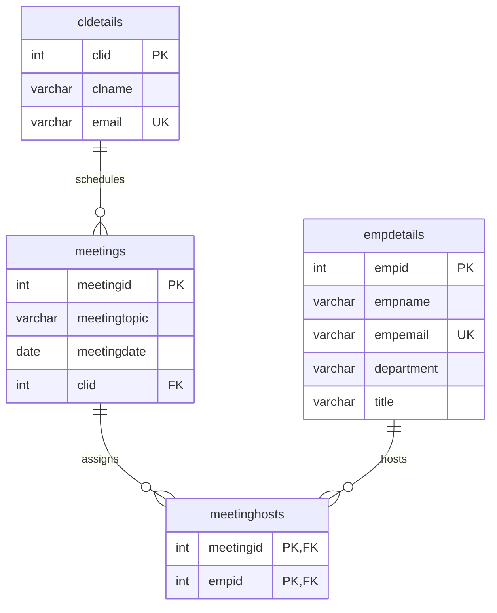

# Client meeting database

A relational scheduling demonstration for MySQL 8.0.16+ or MariaDB 10.6+. The SQL creates clients, employees, meetings, host assignments, and reusable reporting views. Contacts are synthetic. This is a database project, with no login application or authentication layer; plaintext demo passwords have been removed.

Load `clientDB.sql` into a **new, empty database** that you select explicitly in your SQL client:

```sh
mysql --user=root --password --execute="CREATE DATABASE clientdb CHARACTER SET utf8mb4 COLLATE utf8mb4_unicode_ci"
mysql --user=root --password clientdb < clientDB.sql
```

PowerShell users can open the MySQL CLI with `mysql --user=root --password clientdb`, then run `SOURCE C:/absolute/path/clientDB.sql;`. This file never drops a database and fails if its tables already exist. It is a fresh-install demonstration, not a migration or reset script. DDL is not transactional in MySQL; a failed setup can leave partially created tables, so use a fresh disposable schema to retry.

`meeting_summary` derives attendance from one client plus assigned hosts and retains unassigned meetings. `client_meeting_emails` includes clients with no meetings. `employee_schedules` includes unassigned employees. Reports order ties by ID, and foreign keys restrict deletion of referenced clients/employees; deleting a meeting removes its host assignments. Email format checks reject obviously malformed values, not every deliverability problem. Applications should validate input and use parameterized SQL.

For long schedules, set `SET SESSION group_concat_max_len = 65535` before selecting report views; MySQL's default aggregate limit may truncate long previews. Output remains a SQL report; an email or HTML consumer must apply its own output escaping. Dates in the sample are fixed for reproducibility.

Run real database integration checks with Python 3 and a MySQL/MariaDB server plus CLI available:

```sh
MYSQL_HOST=127.0.0.1 MYSQL_PORT=3306 MYSQL_USER=root MYSQL_PASSWORD=your-password python test_database.py
```

On PowerShell, set the same values using `$env:MYSQL_HOST`, `$env:MYSQL_PORT`, `$env:MYSQL_USER`, and `$env:MYSQL_PASSWORD`, then run `python test_database.py`. `MYSQL_BIN` optionally supplies an absolute CLI executable path. The runner creates a unique `clientdb_quality_test_<uuid>` schema, checks SQL execution, seed counts, views, data constraints, referential restrictions, host deletion behavior, and safe rerun failure, and removes that schema afterward. It requires database creation/deletion privileges; it never drops a preexisting user schema. An absent service or CLI is an error, never a passing or skipped database test.

The Workbench `.mwb` file is the original design artifact, retained for project history. Its password and stored-attendance fields predate the revised schema; the SQL and diagram below describe the current model.


